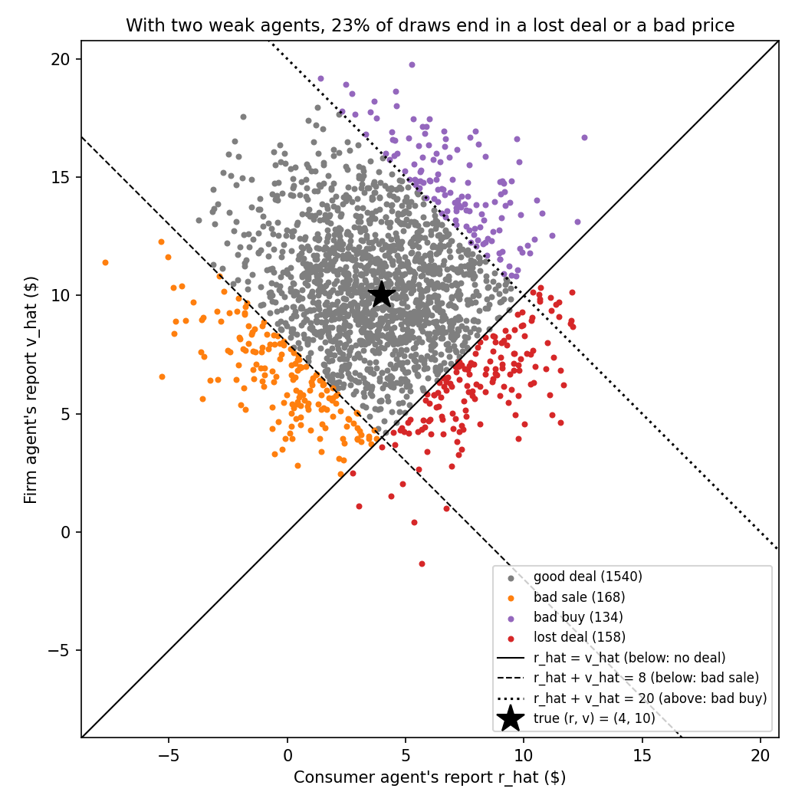
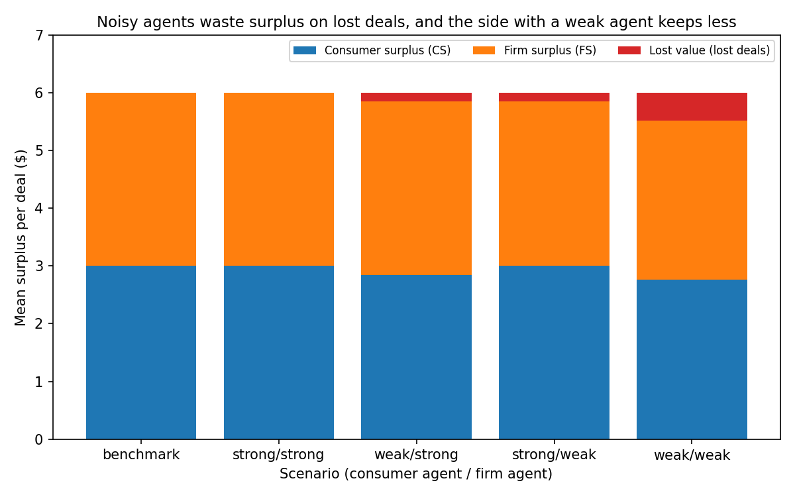
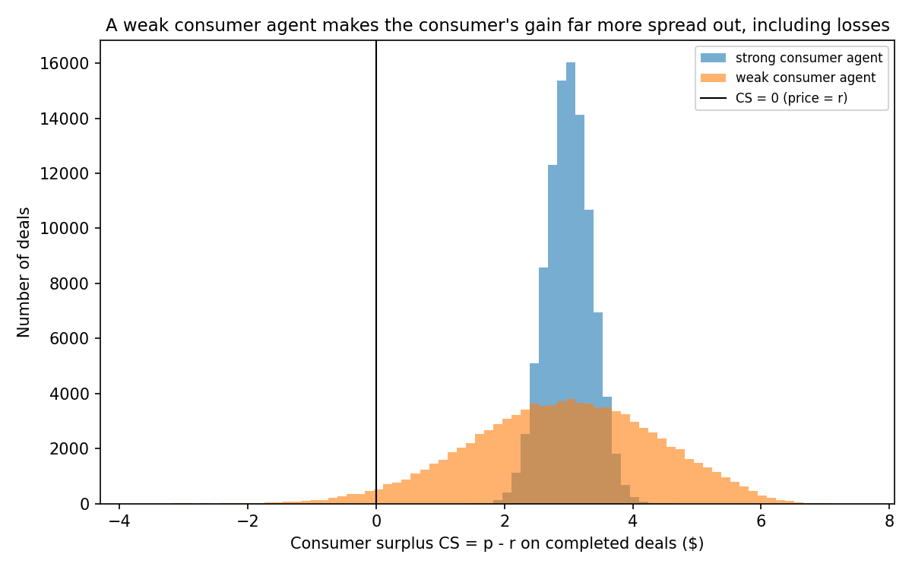
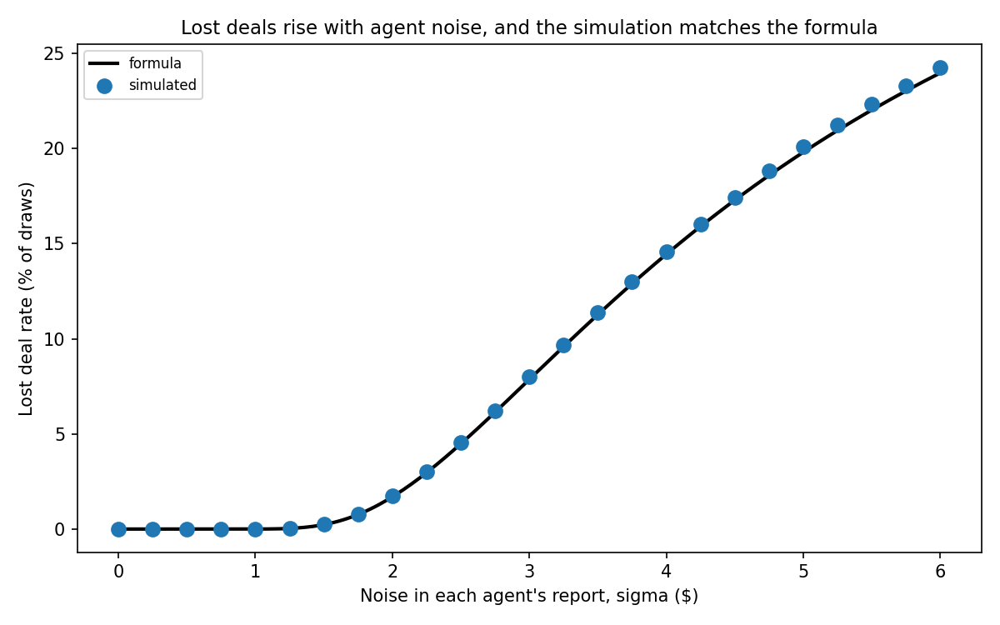

# Data Bazaar v0

A toy simulation of one data sale in which AI agents bargain for a consumer and a firm. It shows how gaps in agent strength and agent knowledge shift who gets the surplus, and how often deals fail.

> **Limitations.** This is a toy that illustrates an argument. It has one consumer, one firm, fixed numbers and a simple price rule. It proves nothing about real data markets.

## The model

A consumer has a private **reservation price** $r = 4$ (the lowest price they would accept for their data). A firm has a private **value** $v = 10$ (the most it would pay). Each side has an AI agent of type *strong* or *weak*:

| agent type | $\sigma$ (noise in its report) | $b$ (bargaining strength) |
|---|---|---|
| strong | 0.5 | 2 |
| weak | 3.0 | 1 |

Each agent reports its principal's number with noise:

$$\hat r = r + \varepsilon_c, \qquad \hat v = v + \varepsilon_f, \qquad \varepsilon \sim N(0, \sigma^2)$$

The bazaar sees only $\hat r$, $\hat v$, $b_c$, $b_f$. It sets the consumer's share $\beta$ and the price:

$$\beta = \frac{b_c}{b_c + b_f}, \qquad p = \begin{cases} \hat r + \beta(\hat v - \hat r) & \text{if } \hat r \le \hat v \\ \text{no deal} & \text{otherwise} \end{cases}$$

Outcomes are scored with the **true** $r$ and $v$:

$$CS = p - r, \qquad FS = v - p, \qquad CS + FS + \text{lost value} = v - r = 6$$

A **lost deal** is no deal even though $r \le v$ (lost value $= v - r$). A **bad sale** is a deal with $p < r$. A **bad buy** is a deal with $p > v$.

**Benchmark** (full information, equal power): $p^* = 7$, $CS = 3$, $FS = 3$, no lost deals.

## Step A: bargaining only ($\sigma = 0$)

| consumer / firm agent | $\beta$ | $p$ | CS | FS |
|---|---|---|---|---|
| strong / strong | 1/2 | 7.00 | 3.00 | 3.00 |
| weak / strong | 1/3 | 6.00 | 2.00 | 4.00 |
| strong / weak | 2/3 | 8.00 | 4.00 | 2.00 |
| weak / weak | 1/2 | 7.00 | 3.00 | 3.00 |

## Step B: learning only ($\beta = 1/2$, 100,000 draws per scenario, seed 0)

Rates are shares of all draws. The formula column is $\Phi\left(-\frac{v - r}{\sqrt{\sigma_c^2 + \sigma_f^2}}\right)$.

| consumer / firm agent | lost deals | formula | bad sales | bad buys | mean CS | mean FS | mean total | std CS |
|---|---|---|---|---|---|---|---|---|
| strong / strong | 0.00% | 0.00% | 0.00% | 0.00% | 3.00 | 3.00 | 6.00 | 0.35 |
| weak / strong | 2.49% | 2.43% | 2.41% | 0.69% | 2.84 | 3.01 | 5.85 | 1.49 |
| strong / weak | 2.42% | 2.43% | 0.76% | 2.37% | 3.01 | 2.85 | 5.85 | 1.50 |
| weak / weak | 7.99% | 7.86% | 7.19% | 7.27% | 2.76 | 2.76 | 5.52 | 2.19 |

## Figures


*2,000 weak/weak draws of the two reports, colored by outcome. The lines mark where deals fail or land at a bad price.*


*Mean CS, FS and lost value per scenario. Every bar totals $6.*


*Consumer surplus on completed deals with a strong firm agent. With normal noise, a weak consumer agent sells below the minimum in 2.47% of completed deals (2.41% of all draws), a strong one in 0%. That rate depends on the noise shape: with clipped or lognormal noise it is 0% here, because a bad sale would need a negative report (see Robustness).*


*Lost deal rate as both agents get noisier: the simulation tracks the formula.*

## Robustness

Does the learning result (Step B) depend on the normal noise or on the size of the deal zone? Every case: weak consumer agent vs strong firm agent ($\sigma_f = 0.5$), $\beta = 1/2$, $r = 4$, 100,000 draws, seed 0. The noise shape is applied to both agents' reports. Benchmark CS $= (v - r)/2$.

- **a) Noise shape** ($v = 10$, $\sigma_c = 3$). *Normal* is the baseline. *Clipped* is the normal report, floored at 0 dollars. *Lognormal* is $\text{true} \cdot e^{z}$, $z \sim N(-s^2/2, s^2)$, $s = \sqrt{\ln(1 + (\sigma/\text{true})^2)}$: same mean and same dollar standard deviation as the normal report, but always positive and skewed right.
- **b) Grid** (normal noise): deal-zone width $v - r \in \{2, 6, 10\}$, so $v \in \{6, 10, 14\}$; $\sigma_c \in \{1, 2, 3, 5\}$.

| case | noise | $v - r$ | $\sigma_c$ | lost deals | bad sales | bad buys | mean CS | mean FS | benchmark CS |
|---|---|---|---|---|---|---|---|---|---|
| a | normal | 6 | 3 | 2.49% | 2.41% | 0.69% | 2.84 | 3.01 | 3.00 |
| a | clipped | 6 | 3 | 2.49% | 0.00% | 0.69% | 2.91 | 2.94 | 3.00 |
| a | lognormal | 6 | 3 | 4.54% | 0.00% | 0.57% | 2.65 | 3.07 | 3.00 |
| b | normal | 2 | 1 | 3.74% | 3.65% | 2.62% | 0.94 | 0.99 | 1.00 |
| b | normal | 2 | 2 | 16.73% | 16.49% | 4.74% | 0.61 | 1.06 | 1.00 |
| b | normal | 2 | 3 | 25.72% | 25.55% | 4.09% | 0.28 | 1.21 | 1.00 |
| b | normal | 2 | 5 | 34.63% | 34.56% | 2.91% | -0.25 | 1.56 | 1.00 |
| b | normal | 6 | 1 | 0.00% | 0.00% | 0.00% | 3.00 | 3.00 | 3.00 |
| b | normal | 6 | 2 | 0.21% | 0.19% | 0.11% | 2.99 | 3.00 | 3.00 |
| b | normal | 6 | 3 | 2.49% | 2.41% | 0.69% | 2.84 | 3.01 | 3.00 |
| b | normal | 6 | 5 | 11.67% | 11.56% | 1.49% | 2.17 | 3.13 | 3.00 |
| b | normal | 10 | 1 | 0.00% | 0.00% | 0.00% | 5.00 | 5.00 | 5.00 |
| b | normal | 10 | 2 | 0.00% | 0.00% | 0.00% | 5.00 | 5.00 | 5.00 |
| b | normal | 10 | 3 | 0.06% | 0.05% | 0.01% | 5.00 | 5.00 | 5.00 |
| b | normal | 10 | 5 | 2.39% | 2.33% | 0.42% | 4.74 | 5.02 | 5.00 |

The size of the weak side's loss depends on noise relative to the deal zone, but the direction holds in every case: the weak consumer never comes out ahead of the benchmark. Where the noise is small relative to the zone (no lost deals), the gap is zero to within simulation error; wherever deals are lost, the weak consumer keeps less than the benchmark and less than the firm.

Two things to notice. Clipping removes bad sales here but leaves lost deals unchanged, and the consumer still ends below 3 dollars. Lognormal noise also removes bad sales, but its right skew (big over-reports) nearly doubles lost deals, so the weak consumer does worse than under normal noise. The width 6, $\sigma_c = 3$ grid cell reproduces the baseline weak/strong row exactly.

## What I learned

- TODO
- TODO
- TODO

## Next steps

- TODO: combine the bargaining gap (Step A) and the knowledge gap (Step B) in one run.
- TODO: v1 with cases where $r > v$, so a correct "no deal" is possible.

## How to run

```bash
pip install -r requirements.txt
python3 run_v0.py
python3 -m pytest
```

## Related work

- Karten, Crow & Jin (2026), "Agent Bazaar: Enabling Economic Alignment in Multi-Agent Marketplaces", Princeton.
- Augusto Gonzalez-Bonorino, "Privacy Brokers" (Substack, Sept 2026).
